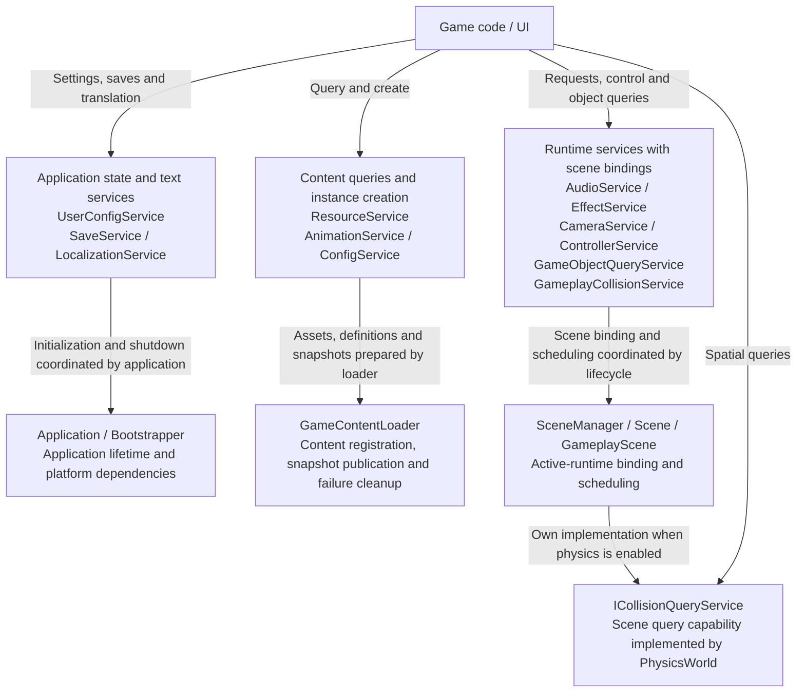

# Service Architecture Overview

This page indexes the current 12 concrete services and one physics query interface. The diagram groups assets, presentation, configuration and scene capabilities; services sharing a box retain independent implementations and lifecycles, without implying a shared owner. See the [complete startup flow](startup.md) for initialization order.

## Service Relationships

Edge labels identify calls or lifecycle cooperation; module diagrams expand cross-service dependencies. Global service entry points do not extend scene, object, resource or listener lifetime.

Source: [application.cpp](../../../engine/application/application.cpp) · [game_content_loader.cpp](../../../engine/loading/game_content_loader.cpp) · [scene_manager.cpp](../../../engine/scene/scene_manager.cpp)

## Per-service Architecture Diagrams

| Service or interface | Architecture diagram |
| --- | --- |
| `ResourceService` | [Resource Service and Loading Architecture](subsystems/resources/README.md#resource-service-architecture) |
| `AudioService` | [Audio Service Architecture](subsystems/audio.md#audio-service-architecture) |
| `CameraService` | [Camera Service Architecture](subsystems/camera.md#camera-service-architecture) |
| `ConfigService` | [Read-only Configuration Service Architecture](subsystems/runtime-config.md#config-service-architecture) |
| `UserConfigService` | [User Configuration Service Architecture](subsystems/runtime-config.md#user-config-service-architecture) |
| `SaveService` | [Save Service Architecture](subsystems/save.md#save-service-architecture) |
| `ControllerService` | [Controller Service Architecture](subsystems/input/architecture.md#controller-service-architecture) |
| `GameplayCollisionService` | [Gameplay Collision Service Architecture](subsystems/physics/07-gameplay-collision-runtime.md#gameplay-collision-service-architecture) |
| `ICollisionQueryService` | [Physics Query Service Contract](subsystems/physics/05-collision-algorithms.md#collision-query-service-architecture) |
| `AnimationService` | [Animation Service Architecture](subsystems/animation-and-effects.md#animation-service-architecture) |
| `EffectService` | [Effect Service Architecture](subsystems/animation-and-effects.md#effect-service-architecture) |
| `LocalizationService` | [Localization Service Architecture](subsystems/localization.md#localization-service-architecture) |
| `GameObjectQueryService` | [Object Query Service Architecture](subsystems/object-query.md#object-query-service-architecture) |

## Reading Boundaries

A Service is not uniformly a Manager wrapper: AudioService, SaveService and configuration services own state; CameraService and the gameplay collision service borrow scene runtimes; ICollisionQueryService is a contract implemented by PhysicsWorld.

Existing non-service topics remain in [UI Architecture](subsystems/ui/README.md), [Scene Lifecycle](subsystems/scene-lifecycle.md) and [Physics Architecture](subsystems/physics/README.md). Return to the [architecture index](README.md).
