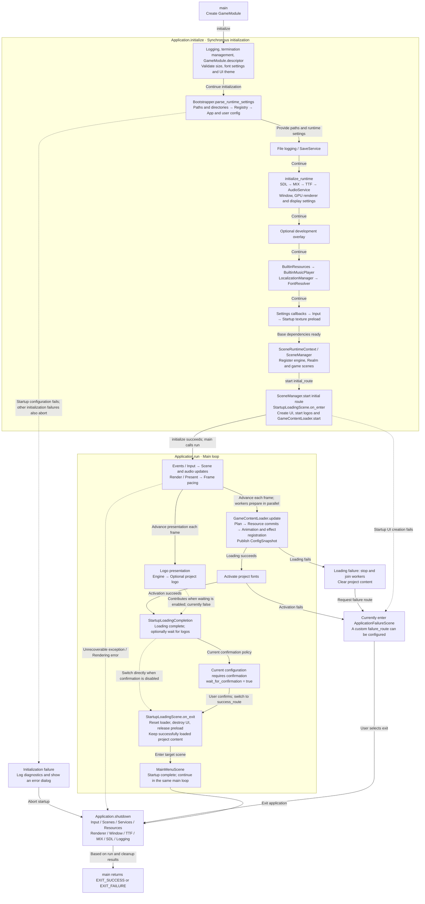

# Complete Project Startup Flow

This diagram follows the current example GameModule initial_route from main to the main menu. Projects may select other initial and success routes; MainMenu is not a fixed engine entry point.

## Initialization and Runtime Phases

Source: [main.cpp](../../../main.cpp) · [application.cpp](../../../engine/application/application.cpp) · [application_scene_composition.cpp](../../../engine/application/composition/application_scene_composition.cpp) · [bootstrapper.cpp](../../../engine/bootstrap/bootstrapper.cpp) · [startup_loading_scene.cpp](../../../engine/builtin/scenes/startup_loading_scene.cpp)

## Current Example and Engine Options

The example enters StartupLoading and then MainMenu on success, with wait_for_logo_sequence=false and wait_for_confirmation=true, and no project logo or custom failure route. The Payload default for waiting on logos is true. Disabling the wait does not stop logo playback; disabling confirmation permits a direct transition.

Source: [example_game_module.cpp](../../../game/application/example_game_module.cpp) · [startup_loading_scene_payload.h](../../../engine/builtin/scenes/startup_loading_scene_payload.h) · [startup_loading_flow.h](../../../engine/builtin/scenes/startup_loading_flow.h)

## Timing and Failure Boundaries

- initialize enters the initial scene. on_enter synchronously prepares manifests and the plan and starts workers; run then advances loading and presentation, without waiting for all project content before entering the main loop.
- Workers prepare CPU data only; GPU creation and commits occur on the main thread. See the [resource service diagram](subsystems/resources/README.md#resource-service-architecture).
- Startup configuration, platform or required preload failure aborts initialization. Ordinary initialization failures use logging and dialogs; unrecoverable rendering errors use the termination boundary.
- Content failure clears workers and project content before requesting failure_route or the built-in failure scene; font activation and startup presentation failures also use failure routing. SceneManager attempts error-scene recovery for ordinary scene lifecycle exceptions and terminates if recovery is unavailable.
- Leaving the startup scene releases preload caches while keeping successfully loaded project content. Application shutdown ends users and playback before releasing assets and platform facilities; cleanup failure affects the exit result.

Solid arrows show the main flow; dashed arrows show conditional or exceptional branches. [Startup configuration guide](../user-guide/builtin-scenes/startup-loading.md) · [Service overview](services.md) · [Scene lifecycle](subsystems/scene-lifecycle.md).
