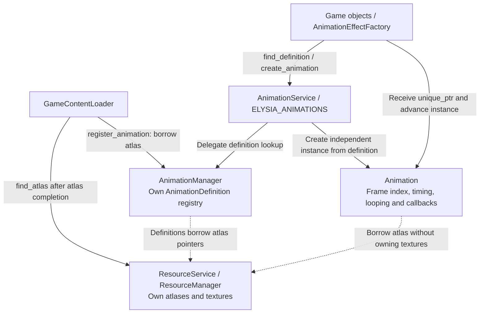
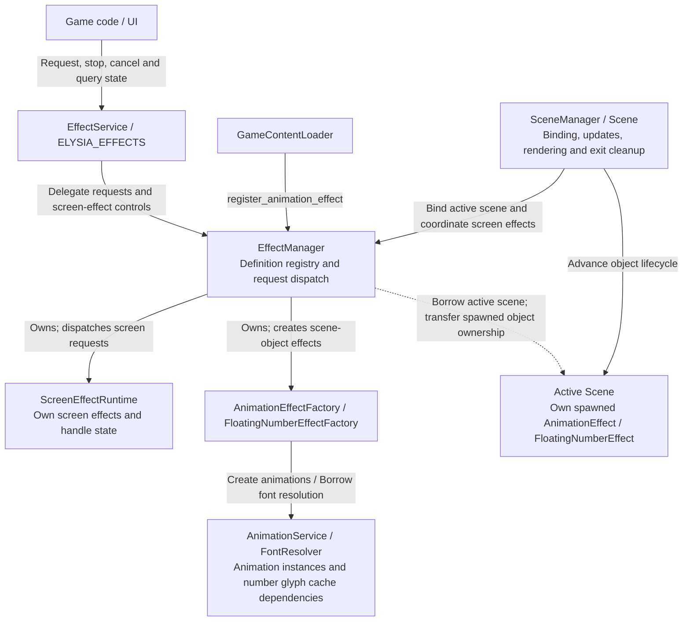

# Animation and Effect Architecture

This page explains shared animation definitions, independent playback instances, effect dispatch and scene ownership. See the [animation and effects guide](../../user-guide/systems/animation-and-effects.md) for integration and [resource loading](resources/README.md) for content registration.

## Animation Service Architecture

The registry stores shared definitions; creation returns animation instances with independent playback state.

find_definition returns a borrow; create_animation returns a caller-owned unique_ptr. Both definitions and instances borrow resource atlases, so old instances and definitions must stop being used before reload. Missing definitions yield nullptr without on-demand loading.

Source: [animation_service.cpp](../../../../engine/animation/animation_service.cpp) · [animation_manager.h](../../../../engine/animation/runtime/animation_manager.h) · [animation.h](../../../../engine/animation/animation.h)

## Effect Service Architecture

The Manager runtime owns screen effects; spawned animation and floating-number effect objects are transferred to the active Scene.

EffectManager borrows the active scene and rendering/font dependencies; unavailable runtimes or definitions return explicit failures. Screen effects do not survive scene exit. Spawned effects follow scene-object lifetimes; EffectService does not load resources.

Source: [effect_service.cpp](../../../../engine/effects/effect_service.cpp) · [effect_manager.h](../../../../engine/effects/runtime/effect_manager.h) · [effect_manager.cpp](../../../../engine/effects/runtime/effect_manager.cpp)

Related: [Service Architecture Overview](../services.md) · [Architecture Index](../README.md).
