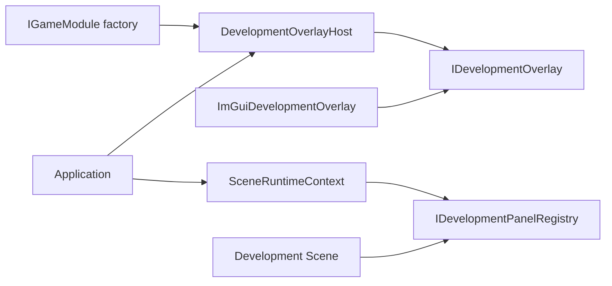

# Development Overlay and Dear ImGui

This document explains the overlay's boundaries with production UI, input, and application lifecycle. Panels unregister before scene exit; the overlay releases backend resources before renderer shutdown.

`DevelopmentOverlay` is the engine's optional slot for developer tools. Production UI, scenes, physics, and gameplay depend only on the general panel registry interface. `Application` coordinates generic lifecycle without including `imgui.h` or directly calling Dear ImGui APIs.

Build options, factory integration, and registration examples are in the [panel guide](../../user-guide/tools/development-panels.md).

## Layers and Ownership

- `IGameModule::create_development_overlay()` returns empty by default; projects create an adapter only in enabled builds.
- `DevelopmentOverlayHost` exclusively owns the adapter, reserves F2, controls visibility, and guarantees no per-frame calls while hidden.
- `SceneRuntimeContext` exposes only a nullable `IDevelopmentPanelRegistry`; scenes do not know the Host or adapter's concrete type.
- `ImGuiDevelopmentOverlay` owns the ImGui context, default font atlas, and two official backends.
- Shutdown order is `SceneManager`, overlay, resources, renderer, window, SDL, allowing scenes to unregister callbacks capturing themselves first.

## Frame and Input Semantics

1. Every SDL event reaches the overlay host first. The host consumes F2 presses and releases before game RawInput.
2. While visible, ordinary events reach the ImGui backend and still pass through `InputSystem` window/device lifecycle handling.
3. `InputSystem` uses `WantCaptureKeyboard`, `WantTextInput`, and `WantCaptureMouse` from the last complete ImGui frame to suppress keyboard, text, or pointer RawInput.
4. Starting capture clears the corresponding held states and mouse deltas to prevent stuck scene input. Ending pointer capture refreshes logical mouse position.
5. The overlay requests no gamepad capture and enables no ImGui gamepad navigation; gamepad events always continue to the game.
6. Call `begin_frame()` before update, overlay `render()` after scenes, `DebugDraw`, and production UI, and finally `SDL_RenderPresent()`.

Before drawing, the adapter saves SDL Renderer's render target, logical presentation dimensions/mode, scale, viewport, clipping, draw color, and blend mode. It restores them in dependency order afterward to avoid contaminating production rendering.

## Registry Execution Boundaries

Panel drawing uses a batch snapshot. Mutations during drawing are queued for the next batch. The registry does not own captured business objects; unregister before scene exit.

Callback exceptions reach the application render boundary, record `UnhandledException`, and enter FaultExit without attempting arbitrary ImGui-state rollback. Complete calling and lifecycle conditions are in the [panel guide](../../user-guide/tools/development-panels.md#registration-and-unregistration).
