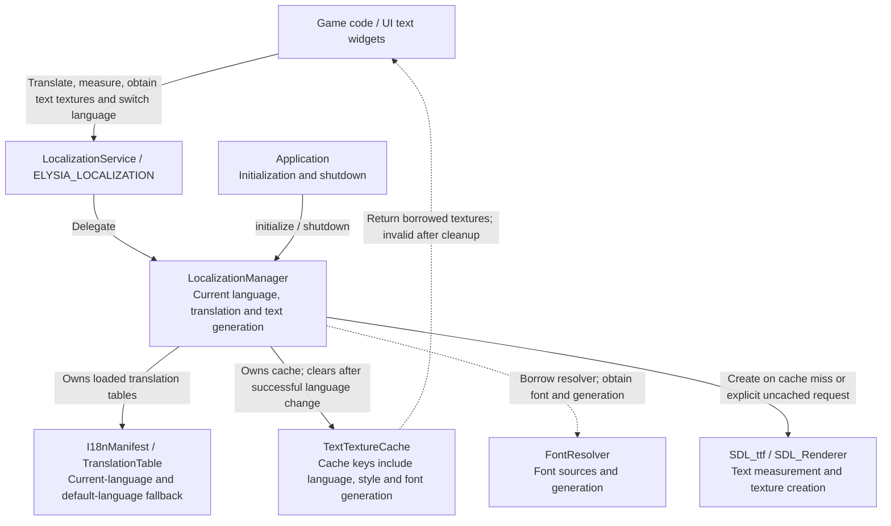

# Localization and Text Cache Architecture

This page explains translation, font resolution and text textures; see the [localization guide](../../user-guide/systems/localization.md) for integration. Localization is initialized before project content loading, with project fonts activated after loading succeeds; see the [startup flow](../startup.md).

## Localization Service Architecture

The service unifies translation, measurement and text textures; the Manager owns translation tables and caches while borrowing the application FontResolver.

Cached textures are borrowed and become invalid after a successful language switch, cache clearing or shutdown. Font generation participates in cache keys to avoid reusing old-font textures. create_uncached_raw_text_texture returns a caller-owned CachedTexturePtr rather than a cache borrow; tr string_view does not extend translation-table lifetime either.

Source: [localization_service.cpp](../../../../engine/localization/localization_service.cpp) · [localization_manager.h](../../../../engine/localization/localization_manager.h) · [text_texture_cache.h](../../../../engine/localization/text_texture_cache.h)

Related: [Service Architecture Overview](../services.md) · [Architecture Index](../README.md).
