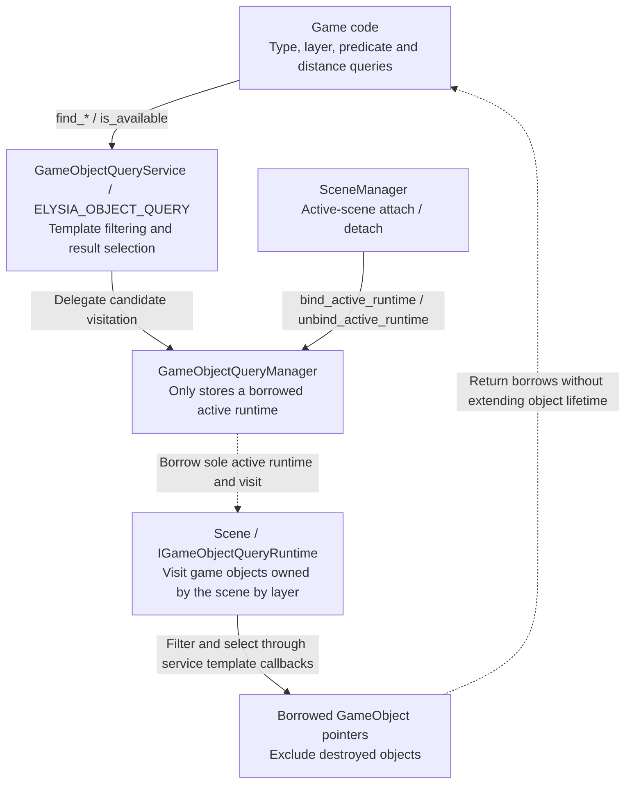

# Active-scene Object Query Architecture

This page explains active-scene access and borrowed query results. See the [object-query guide](../../user-guide/systems/object-query.md) for usage and the [collision query contract](physics/05-collision-algorithms.md#collision-query-service-architecture) for physics geometry queries.

## Object Query Service Architecture

The global entry visits the object collection supplied by the current Scene; service templates perform type, predicate and score selection.

Results are borrowed, provide neither a spatial index nor exact physics tests, and do not extend object lifetime. is_available reports whether a runtime is bound; queries without candidates yield empty results. Re-query after scene switches or destruction, and obey scene safe-mutation phases during visitation.

Source: [game_object_query_service.h](../../../../engine/object_query/game_object_query_service.h) · [game_object_query_manager.cpp](../../../../engine/object_query/runtime/game_object_query_manager.cpp) · [scene.h](../../../../engine/scene/scene.h)

Related: [Service Architecture Overview](../services.md) · [Architecture Index](../README.md).
