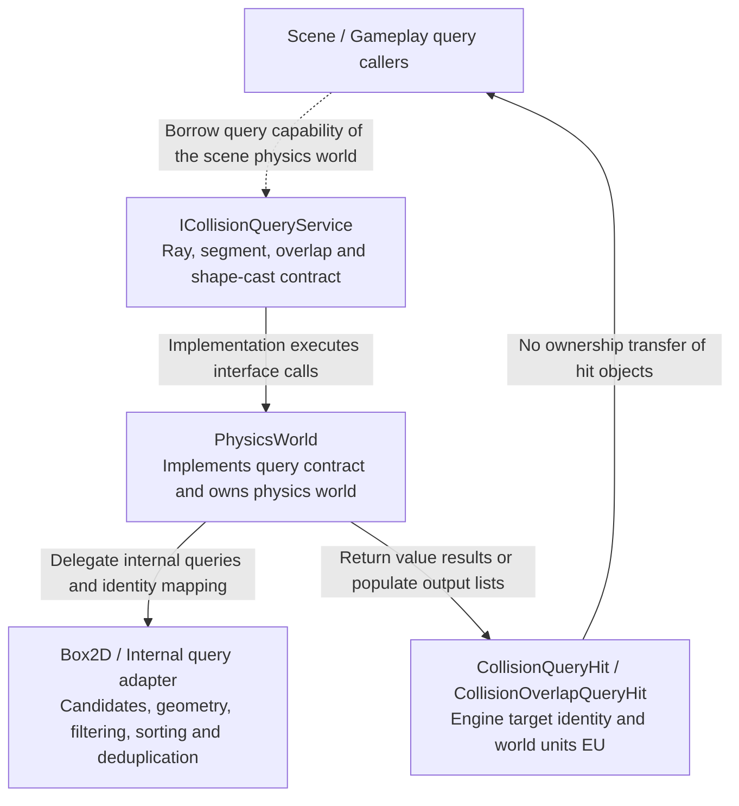

# Collision Processing and Spatial Queries

Box2D handles broad-phase candidates, precise collision, continuous collision, and constraint solving. Elysia adds filtering, results, and gameplay integration without maintaining a second solver.

## Physics Query Service Contract

This is an abstract capability implemented by PhysicsWorld, rather than a global Service singleton.

Results use engine identities and EU without exposing native Box2D objects. They do not own hit objects, and identity validity follows physics-object lifetime. Spatial queries and GameObjectQueryService collection filtering are separate capabilities.

Source: [collision_query_service.h](../../../../../engine/physics/contracts/collision_query_service.h) · [physics_world.h](../../../../../engine/physics/physics_world.h)

## Filtering and Shape Responses

Engine category/mask/group filtering maps to native shapes. Overlap shapes become sensors; Ignore shapes create no native collision shape. Materials supply friction and restitution.

## Query Results

Ray and segment casts return nearest or all hits. `overlap_shape`, `shape_cast` and `shape_cast_all` precisely test boxes, circles, capsules and convex polygons with a world pose. Casts translate without rotating. Initial overlap reports `initial_overlap=true`, zero distance/fraction, the query origin and a zero normal; these are not a contact manifold.

Results use engine IDs and world units (EU). All-hit results sort by fraction and engine target and deduplicate shape hits. `CollisionQueryFilter` supports categories/masks/groups, excluding all colliders of one object and excluding sensors. Positive equal groups force query hits even for zero-mask targets. Overlap results identify shapes without extra penetration manifolds.

## Fast Attacks

Cast the attack shape, process hits in travel order, and stop at blocking geometry. Sensor `Begin` represents discrete sampled contact and cannot replace fast casts. Box2D native CCD/contact semantics are in its [simulation documentation](https://box2d.org/documentation/md_simulation.html).

Segment is a zero-thickness two-sided target; Chain uses connected one-sided edges with local front normal `(dy, -dx)`. Chain solving and rays follow winding, while overlaps and shape casts are geometric. A cast hit does not imply physical blocking. Sources remain the four area-bearing shapes, and ignoring an owner excludes all Chain children.
