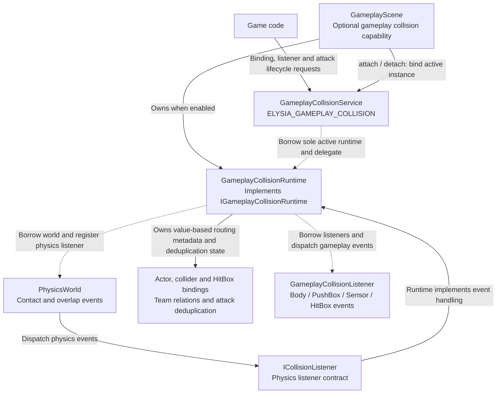

# From Physical Contacts to Gameplay Events

Physics reports engine shape identities and contact/overlap values, not hostility or damage. `GameplayCollisionRuntime` owns actor/team/role bindings and converts results into Body, PushBox, Sensor, and HitBox events.

## Gameplay Collision Service Architecture

The physics world produces contact facts; the gameplay runtime interprets bindings, teams and attack instances before dispatching gameplay events.

The service only borrows the active runtime and owns neither actors nor listeners. Unbinding does not clear a cached scene collision runtime; Reset does not automatically call collision_runtime.clear either. Listeners must outlive the event batch, and games decide damage policy.

Source: [gameplay_collision_service.cpp](../../../../../engine/gameplay/collision/gameplay_collision_service.cpp) · [gameplay_collision_runtime.h](../../../../../engine/gameplay/collision/gameplay_collision_runtime.h) · [gameplay_scene.cpp](../../../../../engine/gameplay/scene/gameplay_scene.cpp)

## Gameplay Policy and Event Lifetime

Attack deduplication and damage policy sit above physics. A sensor alone does not imply damage.

On `Begin`, HitBox routing checks hostility through `team_relation(hit_box.collider.team, hurt_box.team)`, then deduplicates by attack instance and victim owner. The attack team is copied at registration, without looking up the instigator's ActorCollisionRig or automatically tracking source team changes. instigator is a nonzero attribution ID whose Actor may be unregistered or already removed. Games decide damage, kill attribution, and whether source removal cancels attacks.

Independent attacks use their own collider.owner without an ActorCollisionRig or an extra identity Collider. Unbinding the source Actor only removes bindings owned by that source, leaving attacks with other owners intact; attack completion still calls end_attack_instance to clear bindings and deduplication. Each ColliderId has one gameplay role, so HitBoxes do not also route BodyContactEvent; physics handles physical responses and wall collision events.

The runtime caches bindings by value for active object pairs, allowing `End` routing after actor unbinding without consulting destroyed Box2D objects. Explicit `GameplayCollisionRuntime::clear()` clears actors, attack deduplication, cached routes, gameplay listeners, and custom team resolver. Reset routes first reset base Scene input, pause, fixed steps, and cameras. `GameplayScene::on_runtime_reset()` resets only its control context, then invokes game `on_reset()`; it does not automatically call collision `clear()`. Leaving a cached scene only detaches active services. Games still clear attacks/listeners according to their rules. Object retirement unbinds colliders; instance destruction releases the runtime itself.

## Discrete Contact and Callbacks

`Begin`, `Stay`, and `End` describe sampled contact. Sensors are discrete; fast attacks require explicit casts. Bullet CCD does not make sensors continuous.

Listeners may request physics changes during dispatch; the current batch remains stable. Listener objects must survive that batch. Scene-object mutations still obey [safe scene phases](../scene-lifecycle.md); physics deferral does not authorize arbitrary scene collection changes.
