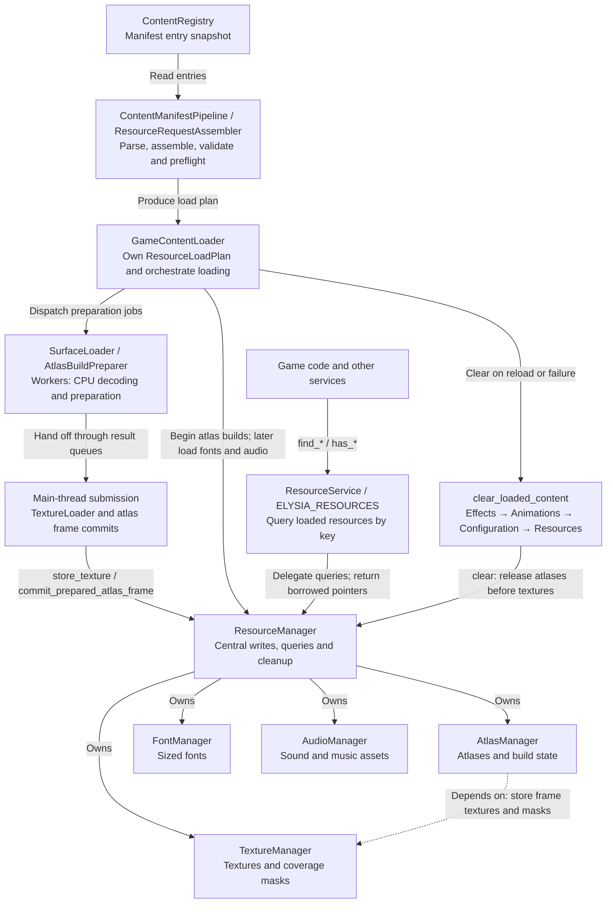

# Resource Loading Pipeline

This page explains request assembly, submission, and handoff to services. For declaring assets, see the [resource guide](../../../user-guide/content/resources.md); complete JSON contracts are in the [format reference](../../../reference/resources/README.md).

## Overall Loading Chain

The loader prepares and commits assets; the service queries already registered resources.

All query pointers are borrowed. Reloads and failures clear project content; ResourceManager clears Atlas, Texture, Font, then Audio. BuiltinResources and BootstrapTextureCache independently own built-ins and preloads outside the project pools.

Source: [resource_service.cpp](../../../../../engine/resources/resource_service.cpp) · [resource_manager.cpp](../../../../../engine/resources/runtime/resource_manager.cpp) · [game_content_loader.cpp](../../../../../engine/loading/game_content_loader.cpp)

Startup configuration, preloads and localization entries are handled during bootstrap and application initialization; project content in the diagram uses the corresponding required and additional manifests. `additional` does not select loaders by module name. New project modules use the same schema and are traversed in deterministic module-name order. `ryougi_sample` has an empty namespace and declares only animation capability; see the [actual configuration chain](../../../reference/resources/entity-content.md#current-repository-example).

The generic loader assembles requests in these stages. An undeclared capability produces no module requests in its stage:

1. Core `Animation`/`Atlas`.
2. `Animation`/`Atlas` from every `additional` module.
3. Core and module EffectDefinition.
4. Core and module Texture.
5. Font, core Audio, and module Audio.

At runtime, `Atlas` completes first, all `Animation` registrations follow, and EffectDefinition registrations come last. An `Effect` therefore binds an existing `Animation`; it does not load images or create animations.

Request origins, keys, and conflict checks are defined in the [format reference](../../../reference/resources/README.md#origins-and-duplicate-keys). Configuration snapshot publication is described in [runtime configuration](../runtime-config.md).
