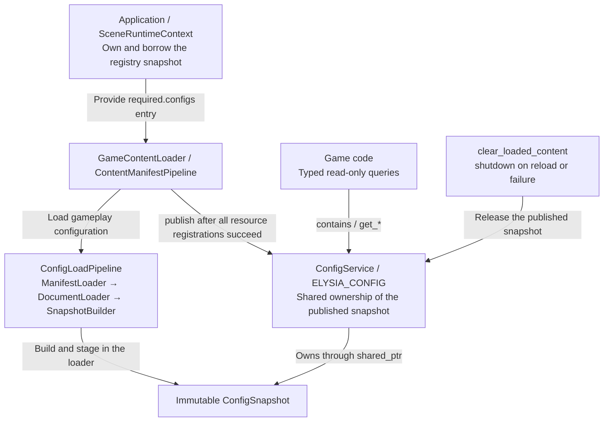
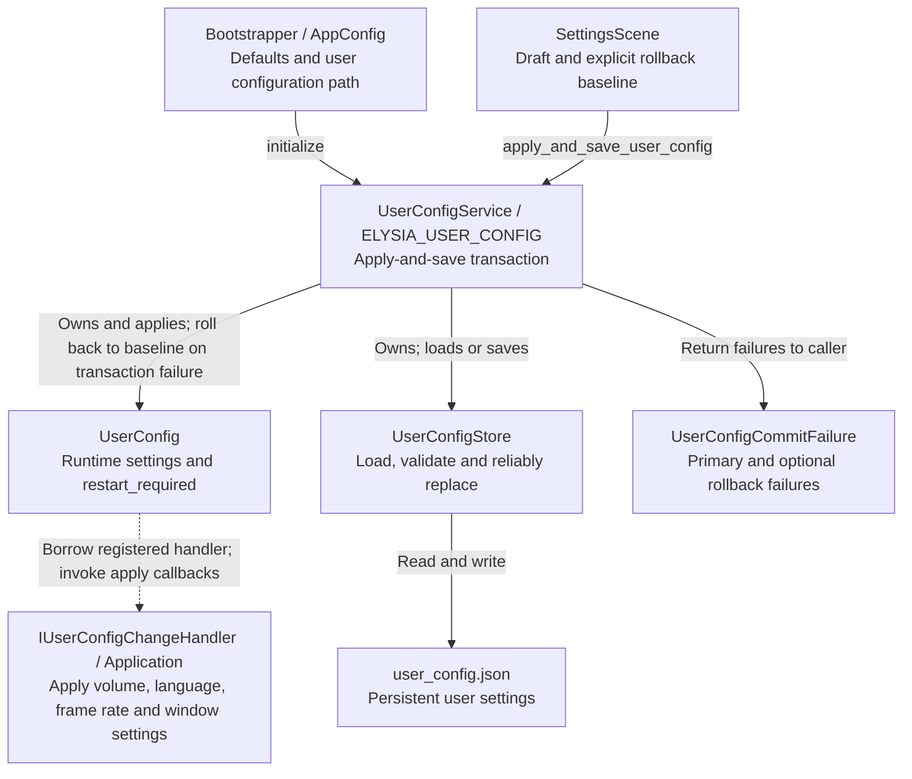

# Runtime Configuration Module

This document describes loading/publication of three configuration categories and distinguishes application failure, disk-write failure, and runtime rollback. Establish the data category before changing configuration services.

Elysia Engine separates configuration into three modules:

| Module | Responsibility | Loading phase |
| --- | --- | --- |
| `AppConfig` | Startup defaults | Bootstrap |
| `UserConfigService` | Global player settings, runtime application, and persistence | Bootstrap, using `AppConfig` defaults |
| `ConfigService` | Read-only gameplay configuration snapshots and typed access | After `GameContentLoader` completes |

## Source Directories

The `engine/config/` root retains stable public entry points and paired implementations: `ConfigService`, `UserConfigService`, `UserConfig`, `user_config_data.h`, and errors, states, and callbacks in `user_config_types.h`.

- `engine/config/content/`: manifests, documents, snapshots, and builders for generic read-only gameplay configuration.
- `engine/config/user/`: runtime user settings and persistence Store.
- `engine/bootstrap/`: `AppConfig`, `RuntimeSettings`, `BootstrapOutput`, and two-stage startup parsing. Bootstrap consumes `config::UserConfigData`; configuration no longer depends back on startup orchestration.

<a id="config-service-architecture"></a>
## Startup and Content Loading

ConfigService receives built snapshots and does not parse files. Startup defaults and user settings follow the UserConfigService diagram below; see the [complete startup flow](../startup.md) for initialization order.



Snapshots are published only after all project content registrations succeed. Failure or reload releases published snapshots without retaining old content; an ordinary loader reset after success keeps published configuration.

Source: [config_service.h](../../../../engine/config/config_service.h) · [content_manifest_pipeline.cpp](../../../../engine/loading/content_manifest_pipeline.cpp) · [game_content_loader.cpp](../../../../engine/loading/game_content_loader.cpp)

Bootstrap neither parses nor publishes gameplay configuration. Content loading, assembly, or registration failure clears partially committed content and leaves `ConfigService` uninitialized. After successful loading, ordinary `reset()` releases temporary loader state while retaining published snapshots/resources. A new `start()` first clears existing content and loads from empty state. Hot reload and retaining old content after reload failure are unsupported.

<a id="user-config-service-architecture"></a>
## User Configuration Service Architecture

User settings have runtime-application and disk-save stages; the settings page also provides an explicit rollback baseline.



Ordinary setters, save_user_config and apply_and_save_user_config have different responsibilities. Rollback in this diagram belongs to the apply-and-save transaction: apply or save failure attempts to restore the baseline, returning primary and rollback failures separately.

Source: [user_config_service.cpp](../../../../engine/config/user_config_service.cpp) · [user_config.h](../../../../engine/config/user_config.h) · [user_config_store.h](../../../../engine/config/user/user_config_store.h)

## AppConfig and UserConfig

`assets/configs/global/app_config.json` uses a strict version-2 schema for the title and window, rendering, audio, and localization defaults. Logical resolution belongs only to `ApplicationDescriptor`, not user configuration:

```json
{
  "schema_version": 2,
  "window": {
    "title": "Elysia Engine",
    "mode": "windowed",
    "windowed_size": { "width": 1280, "height": 720 }
  },
  "render": { "fps": 60, "vsync": true },
  "audio": { "master_volume": 100, "music_volume": 100, "sound_volume": 100 },
  "localization": { "language": "en" }
}
```

Unknown, missing, duplicate, or invalid fields fail startup. Window dimensions and FPS must be positive; volumes lie in `0..100`; title and language cannot be empty. `render.fps` caps presentation rate. VSync waiting and this frame's update/render time share one budget; software pacing waits only for the remainder.

`player_data/user_config.json` stores complete window/render/audio/localization snapshots without the window title. Both configuration formats accept only strict v2. Old v0/v1 `UserConfig` is archived as invalid and rebuilt from `AppConfig` defaults. `.tmp`/`.bak` recovery, corrupt-main archival, and future-version protection remain.

Window mode accepts only `windowed` or `borderless_fullscreen`. `windowed_size` always preserves `windowed` dimensions; desktop borderless fullscreen does not overwrite them.

Built-in `SettingsScene` commits a draft. Editing controls does not immediately change runtime state. Save applies and persists the batch through `UserConfigService::apply_and_save_user_config()`. The transaction explicitly carries `UserConfigRuntimeState` captured on entry or the last successful save as its rollback baseline. Failed application/persistence therefore does not roll back to incidental state just before Save. Rollback failure is returned separately; the page refreshes from actual `UserConfig` runtime state.

FPS applies immediately to software pacing. VSync is saved for next startup with a restart indicator; returning it to the value actually used this startup clears pending restart. The form groups Display, Audio, and General in one vertical scroll area while title, status, and Save/Back remain fixed. See [SettingsPanel](../../reference/ui/settings-panel.md#settings-panel) for layout and visibility.

## Generic Gameplay Configuration

The entry point is `assets/configs/manifests/config_manifest.json`, referenced by `manifests.required.configs`:

```json
{
  "schema_version": 1,
  "configs": {}
}
```

`configs` maps namespaces to document paths. It is currently empty; future character, skill, and level documents register here for content-stage loading. The manifest is strict. Referenced roots may be object, array, string, boolean, or number, but not `null`.

Root values register under namespace keys; object fields expand recursively; array indexes use unpadded `.0/.1/...` components. For example:

```json
{
  "difficulty": { "enemy_health_scale": 1.0 },
  "spawn_points": [{ "x": 100, "y": 200 }]
}
```

With namespace `game`, keys include `game.difficulty.enemy_health_scale` and `game.spawn_points.0.x`. Namespaces and field components match `[A-Za-z0-9_]+`. Duplicate properties, `null` at any depth, invalid components, and complete-key conflicts fail before publication, preserving document paths, JSON pointers, and first/duplicate origins.

`ConfigService` parses neither files nor JSON. It provides `publish`, `contains`, six scalar/geometric getters, and their array variants. Access failures return `expected` with logging deduplicated by error category. It exposes neither raw JSON, optional/default fallback, hot reload, nor business-specific interfaces.
