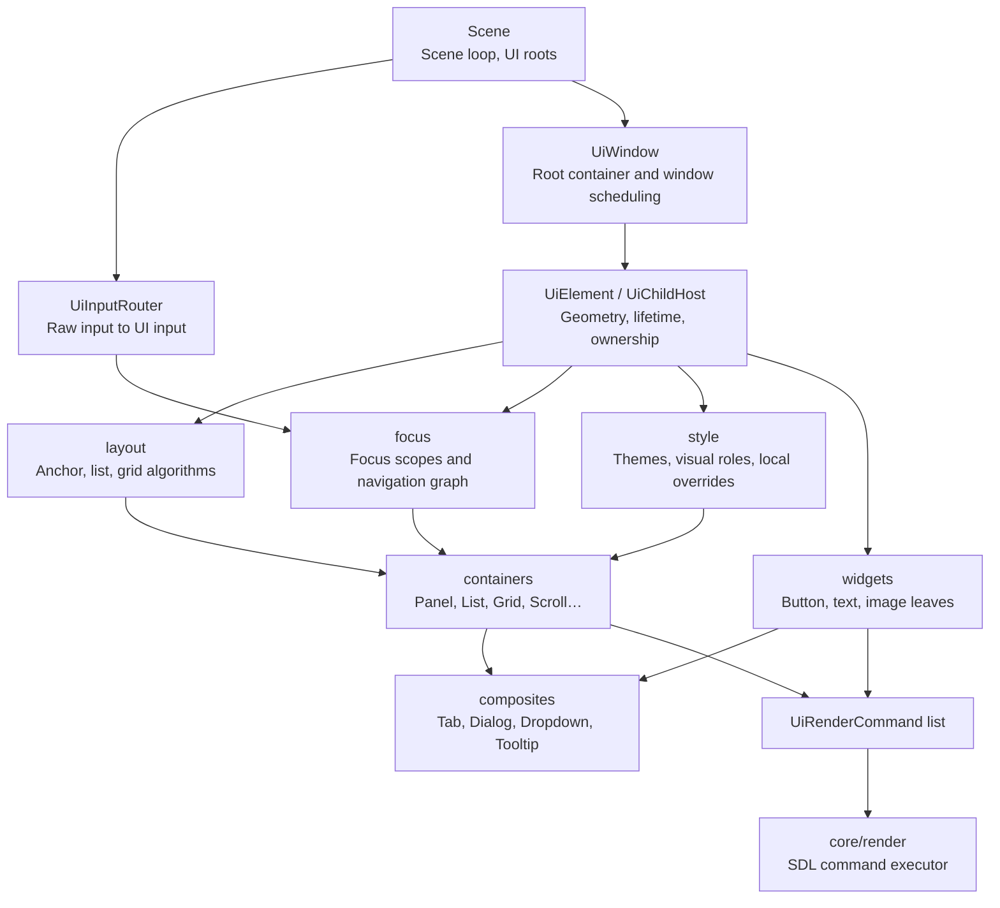
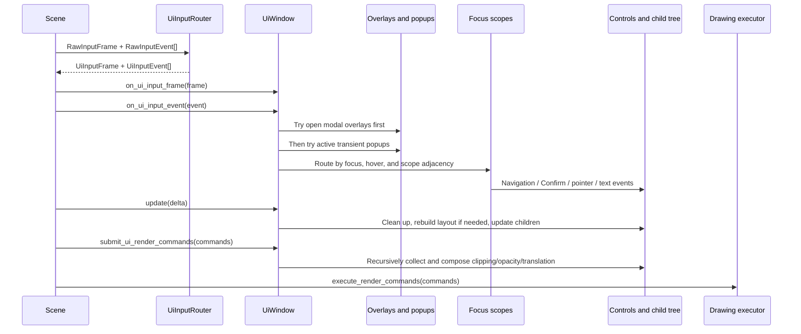
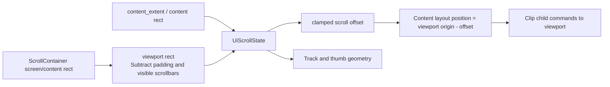
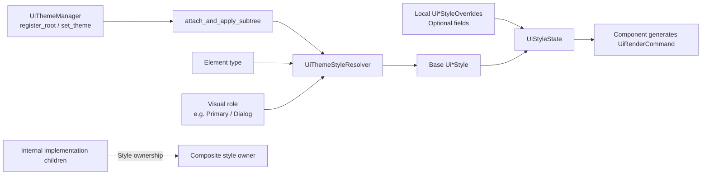

# UI Architecture and Runtime Flow

For developers maintaining UI implementations, this document explains module cooperation through the element tree, frame execution, layout/presentation, focus surfaces, and theme propagation. See the [UI guide](../../../user-guide/ui/README.md#create-window) for game integration and the [UI reference](../../../reference/ui/README.md) for interfaces.

<a id="element-tree"></a>
## Element Tree and Ownership

Elysia Engine uses **retained-mode UI**: code creates `UiElement` objects and retains them as a tree. Each frame updates tree state, rebuilds layout when needed, and collects rendering commands. Widgets do not call SDL drawing APIs directly.



Three boundaries matter most in this diagram:

1. `engine/ui` handles **state, layout, input, and command generation**, but does not draw to the SDL renderer.
2. `UiChildHost` is the shared foundation of container capabilities. Concrete containers mainly replace layout and focus graph construction.
3. `UiWindow` is a UI root container, not an OS window wrapper. It handles window-level semantics: focus across scopes, overlays, popups, tooltips, and scroll routing.

`Scene` connects UI to the game loop. It stores UI roots, processes them by UI `order`, and hands batches of `UiRenderCommand` to rendering infrastructure in [scene.cpp](../../../../../engine/scene/scene.cpp).

[`UiChildHost`](../../../../../engine/ui/core/ui_child_host.h) inherits `UiElement`, `Updatable`, `UiInputFrameReceiver`, and `UiInputEventReceiver`. A container is thus both a tree node and the scheduler for subtree updates, input, and rendering.

When taking ownership of a child, a container establishes the `layout_parent` backlink, invalidates layout, and attaches/applies the theme subtree if a theme manager already exists. Removal and reset undo those relationships. Keep this model when reading code: containers own the tree; windows, themes, and layout retain borrowed registrations only.

See [elements and layout](../../../reference/ui/elements-and-layout.md#ownership) for public construction, extraction, and release contracts. Internal child records also track lifetime. Traversal uses verifiable handles to recognize objects removed or destroyed by tree-mutating callbacks.

<a id="frame-flow"></a>
## How a Frame Executes

The scene's internal lifecycle input entry point delegates to `SceneInputRouter`, first passing `RawInputFrame` to `UiInputRouter::route_frame`, then converting discrete raw events to `UiInputEvent`. Continuous action events are synthesized when needed. The scene then dispatches frames and events in UI input `order`. `UiInputFrame` answers whether something is currently held; `UiInputEvent` handles discrete presses, wheel movement, pointer movement, and text input. The diagram summarizes the main path, omitting branches for absent input, pause, or already consumed events.



Layout does not occur only during update: `UiChildHost` also calls `update_layout_if_dirty()` before input and render command submission. This avoids stale geometry when `content` changes immediately before a click or render, without waiting for the next update. Layout is deferred and performed on demand.

After ordinary updates, the scene's internal lifecycle update entry point separately recurses through `update_presentation_animations(delta)`; scene objects cannot be added or removed during that traversal. Games extend `on_before_update` / `on_after_update` without calling base scheduling. Translation animation therefore should not modify layout rects: layout geometry stays fixed while presentation-to-layout conversion makes pointer hit testing follow the image.

`SceneInputRouter` (`engine/scene/input/`) coordinates UI consumption and device capture before forwarding allowed input to shortcuts and local controllers. Keyboard capture spans partitions; mouse capture follows mouse ownership; gamepad capture affects only the designated UI gamepad. See [input reference](../../../reference/ui/input-and-focus.md#capture-and-cancel) for public interaction conditions.

Interaction cancellation may invoke game callbacks. `UiChildHost` and scene input routing process batches using stable lifetime snapshots: removed objects are no longer accessed, and new objects do not join the current batch. After catching the first exception, cancellation continues for other live objects before propagation.

<a id="layout-presentation"></a>
## Layout Invalidation and Presentation Composition

**Layout invalidation chain**: when child size or intrinsic `content` changes, `UiElement::notify_layout_parent_of_intrinsic_layout_invalidation()` notifies its parent. The parent marks a rebuild and propagates upward. `UiChildHost` uses `_is_rebuilding_layout` and `_layout_dirty_after_rebuild` to avoid recursive confusion from invalidation during rebuild. Parents should adjust layout through padding, child options, or container APIs instead of manually changing child rects in conflict with parent layout.

**Render composition**: containers filter destroyed/invisible children, stable-sort by `order`, and let each child append commands. For that newly appended range, the container applies child presentation translation, parent opacity, and optional `content_rect()` clipping in `order`. A parent can thus implement clipping and opacity uniformly without every leaf repeating it.

`screen_rect` is the allocated layout rectangle; `content_extent()` reports measured size to parents. `presentation_screen_rect()` and `presentation_to_layout_point()` connect rendering and input through presentation translation. Opacity, clipping, and translation affect only the associated child's appended command range. Drawing is ultimately executed by rendering infrastructure outside the UI module.

See [layout reference](../../../reference/ui/elements-and-layout.md#fixed-layout) for anchors, padding, size overrides, and cross-axis fields. Implementation differences follow.

Text components report measurements to parent layout, then submit text commands. `UiNumber` reuses localized texture caches per character and generates commands with the shared glyph sequence layout algorithm. Target height and scale do not create different-sized font textures; both characters in `--` share one minus texture. Formatting and layout still run on every command submission.

### UiPanel: Anchor Layout and Directional Adjacency

`UiPanel` suits local layouts that are neither pure lists nor grids. Direct insertion with `UiLayoutChildOptions` uses anchor layout. `add_child(child, UiPanelInsertDirection)` advances Up/Down/Left/Right relative to the latest focusable insertion point and records `FocusLink`. Later, `rebuild_focus_registry()` converts those relationships into control adjacency.

Insertion direction therefore affects focus navigation as well as visual position. Nested child focus scopes retain their own navigation graphs through delegation. Panels also hold `UiPanelStyle` and `UiPanelVisualRole`, supporting surfaces with semantic roles such as backgrounds, borders, or dialogs.

**Avoid** using a panel as an indefinitely growing vertical list, or repeatedly changing child rectangles after insertion. Use a list for the former; the next layout rebuild overwrites manual positions in the latter.

### UiListContainer: One-Dimensional Flow Layout

Lists convert `UiListDirection::Vertical` / `Horizontal` into the layout main axis. `rebuild_layout()` reads each child's size override or `content_extent()`, places children in `order` with `item_spacing`, then applies cross-axis Start/Center/`End` through `cross_align`, optionally filling that axis. `content_extent()` sums item sizes, spacing, and padding for outer lists or scroll containers to measure.

Focus follows the same one-dimensional semantics: main-axis navigation first moves between adjacent items/delegated scopes; other directions may be left to the parent scope. `add_front` and `add_back` change list `order` and consequently layout, drawing, and focus adjacency.

### UiGridContainer: Two-Dimensional Cells and Navigation

Grids use `column_count`, `cell_spacing`, and `fill_by_row`. The layout layer derives row/column positions from the current child count and allocates cells. `fill_by_row=true` fills left to right then wraps; false fills columns. `content_extent()` reflects cell size, row/column count, spacing, and padding.

Unlike lists' sequential neighbors, grid focus registries build up/down/left/right neighbors from row/column coordinates. This suits truly two-dimensional selection interfaces. For a two-column settings form with tab-`order` navigation, a list plus panel is often more intuitive.

### UiScrollContainer: Content, Viewport, and Input Routing

ScrollContainer deserves close reading. It inherits `UiChildHost` and implements `UiFocusScope`, but publicly **manages one `content` object only** through `set_content`, `content`, and `clear_content`. Its internal `UiScrollState` depends on viewport size, `content` size, offset, simulation step, and axis.



- `UiScrollAxis::Auto` resolves to `Horizontal`, Vertical, or Both according to `content` overflow on x/y. `max_scroll_offset` is `content` size minus viewport size, clamped nonnegative.
- `rebuild_layout()` measures `content`, synchronizes state, determines scrollbar visibility, recalculates the actual viewport, and places `content` at `viewport.position - scroll_offset`. It forces `clip_children=true` to prevent drawing outside the viewport.
- Scrollbars can be Hidden, Visible, or Auto. An internal `UiDragHandle` acts as the thumb, but ScrollContainer owns scrollbar semantics: thumb position maps to a `UiScrollState` ratio, then an offset.
- Event priority: an actively dragged scrollbar goes first; pointer wheel events may first reach hit `content`; if unconsumed, the container attempts scrolling. Ordinary pointer/action events delegate to `content` by hit region. Windows coordinate passive scrolling inputs such as `PageUp`, `PageDown`, `Home`, and `End`.
- The `content` focus scope is the container's focus target. Actual gamepad scrolling may temporarily clear `content` focus and restore it when appropriate, avoiding conflicting focus hints. After relevant input, focused child controls automatically scroll into view through `ensure_visible`.

Nested ScrollContainers do not all scroll together. Windows dispatch inward along the logical focus path so deeper scrollable containers consume first. Do not bypass `UiWindow` by manually sending page-scroll events to every layer.

### UiChromeContainer: Internal Header and Body Composition

ChromeContainer demonstrates the project's preferred composition: `reset()` creates four internal containers—a left action list, title slot, right action list, and body slot. Public APIs expose intent through `add_left_action`, `add_title_child`, `add_right_action`, and `set_body`, rather than exposing internals.

`rebuild_layout()` divides header/body rects using header visibility, header height, and header/body padding, then lays out the four slots. Header action lists use a special internal list that retains list layout but does not become an independent focus scope, keeping implementation structure out of public navigation.

The header container manages direct header controls. If the body is a `UiFocusScope`, navigation enters its delegated scope. Pointer hits on header or body determine event routing; keyboard/gamepad can enter and leave between them. Internal children are marked as composite implementation details, so theme refresh belongs to the header container's semantic style rather than treating them as independent component roots.

### Tabs and Selection Groups: State-Synchronizing Containers

`UiTabView` shows only the page at `_selected_index`; other pages have both `visible=false` and `active=false`, so they do not draw, update, or receive input. Selection changes rebuild layout and focus registrations; focus delegates to the selected page's scope. `UiTabContainer` composes `UiTabBar` and `UiTabView` above this layer, coordinating tab labels, focused tab, and selected page.

`UiButtonGroup` builds on `UiListContainer` and accepts only `UiButton`. It inserts group selection logic before button click callbacks, maintains one selected button, and refreshes style through `Primary` / `Default` visual roles. With `auto_select_first`, losing selection selects the first valid button.

`UiRadioGroup` is also a list, for members implementing `UiRadioItem`. Synchronization preserves the currently focused selected item first, otherwise the first selected item, otherwise the first radio button, and clears others. `set_on_selection_changed` receives one callback per selection change. Deferred synchronization during rendering uses a pending flag to avoid losing notifications.

<a id="focus-surfaces"></a>
## Focus Tree and Window Surface Arbitration

`UiControl` adds interaction semantics such as enabled/focused. `UiFocusScope` defines an independent navigation boundary; `UiControlFocusScopeHost` combines them. It maintains `FocusEntry { control, neighbors }` and synchronizes at explicit lifecycle boundaries: remove invalid children, update layout, rebuild registrations, repair invalid focus, and push visual focus state to controls.

Directional/gamepad navigation first lets the current control handle the event. If unconsumed, it finds a neighbor in the current scope's `UiFocusNeighbors`. Only at a boundary does `UiWindow` try another scope through `UiFocusScopeNeighbors`. Pointer devices can use hover focus; windows record the device that most recently drove focus decisions to distinguish mouse and keyboard/gamepad experiences.

Nested containers cannot flatten all descendant controls into one list. `UiDelegatedFocusMixin` lets panels, lists, header containers, tabs, and other composites delegate to internal child scopes. Parents retain responsibility for entering/leaving scopes. This preserves independent navigation and hierarchy in nested scroll pages, tab pages, and header container bodies.

Windows retain borrowed registrations for scopes, overlays, transient popups, and tooltips. Focus cleanup distinguishes temporary unavailability from leaving the ownership tree: hiding or deactivation suppresses selection/navigation while preserving registration `order`, adjacency, and valid focus history. Destroyed scopes or those outside the subtree are removed.

Before opening a modal layer, the window records a restorable scope. On closing, it restores still-available history or selects again. Windows coordinate modal overlays and active popups before ordinary scopes; tooltips stay passive and draw last. Placement, transitions, and close options belong to window registration state, not the element's object lifetime. See [window surface reference](../../../reference/ui/windows-and-popups.md) for full conditions.

<a id="theme-flow"></a>
## How Themes Propagate Through Subtrees

Themes do not make each control read global colors independently. After registering a root, `UiThemeManager` attaches and applies the entire subtree. `UiThemeStyleResolver` selects base style by element type and visual role; `UiStyleState` overlays only explicitly set fields.



`UiChildHost` automatically attaches the existing theme manager to newly owned children. `on_child_base_style_invalidated` identifies composite implementation children and refreshes their semantic owner instead. Internal nodes of header containers, dialogs, and tabs thus follow the composite semantic theme rather than becoming independent user-placed theme roots.

Local overrides intentionally change selected fields within one theme. Copying full base styles into game code weakens theme switching. Visual roles describe design purpose, such as `Primary`, `Danger`, or `Dialog`; do not confuse them with overrides.

`UiThemeStyleResolver` decides type adaptation and subsequent traversal policy; `UiThemeManager` traverses the whole tree. `UiStyleState` composes base style with sparse field overrides, without managing tree lifetime. See [style reference](../../../reference/ui/style-and-theme.md) for default themes, registered objects, and color role contracts.

<a id="extension-checks"></a>
## Custom Controls and Troubleshooting

Before adding a container, decide whether it needs only `UiChildHost` or also `UiFocusScope` / `UiControlFocusScopeHost`. Then check:

1. **Ownership**: are children acquired only through `unique_ptr`? Do removal/reset clear every borrowed registration and cached raw pointer?
2. **Layout**: which settings call `mark_layout_dirty()`? Does `content_extent()` reflect child `content`? Does rebuilding write only allocated child rects?
3. **Input**: are frame broadcasts and discrete events ordered consistently? Can hits, dragging, or consumed events incorrectly propagate downward?
4. **Focus**: is the registry rebuilt? Can focus recover when children are disabled, hidden, or destroyed? Are nested scopes merged or delegated?
5. **Rendering**: are visible/`order` respected? Are parent opacity, presentation translation, and clipping applied once to the correct range?
6. **Themes**: are visual role and style state explicit? Should internal children be marked as composite implementation details?
7. **Tests**: cover at least child removal, relayout after size changes, keyboard/gamepad navigation, pointer hits, nested containers, and theme or surface registration lifetime.

Frequent failures come from four misunderstandings: retaining borrowed pointers after container destruction; changing child rects while forgetting parent layout rebuilds; failing to manage overlay/popup/tooltip registration lifetime; and treating nested scopes as ordinary children without delegation. Check these boundaries before specific widget logic.

<a id="source-reading"></a>
### Reading Implementations Through Examples and Tests

[`ui_component_gallery_scene.cpp`](../../../../../game/showcase/ui/ui_component_gallery_scene.cpp) is a comprehensive entry point for composition. It builds this actual structure:

```text
UiWindow
├── Status UiLabel
├── UiTabContainer
│   ├── UiTabBar (internal)
│   └── UiTabView (internal)
│       └── Each page: UiScrollContainer
│           └── UiListContainer
│               └── UiChromeContainer
│                   ├── Header actions and title (internal slots)
│                   └── Body: UiListContainer / UiPanel / various controls
├── Overlay UiPanel / UiDialog / UiConfirmationDialog
└── UiTooltip
```

Start at the scene's UI rebuild entry point to understand tabs and the shared window, then read `ui_gallery_pages.h` and `ui_component_gallery_content.cpp` in the same directory. Observe lists wrapped by scroll containers, header/body composition, and container, popup, and theme page configuration. Every pointer saved with `get()` here is borrowed before ownership transfer through `std::move`; its lifetime is controlled by the final container.

Tests and implementation corroborate each other:

- [`ui_callback_safety_tests.cpp`](../../../../../tests/ui/ui_callback_safety_tests.cpp), [`ui_style_tests.cpp`](../../../../../tests/ui/ui_style_tests.cpp), [`ui_popup_lifecycle_tests.cpp`](../../../../../tests/ui/ui_popup_lifecycle_tests.cpp), and [`ui_presentation_tests.cpp`](../../../../../tests/ui/ui_presentation_tests.cpp): ownership, removal, theme attachment, overlay/tooltip lifetime, and rendering ranges.
- [`ui_focus_tree_tests.cpp`](../../../../../tests/ui/ui_focus_tree_tests.cpp): nested focus behavior for lists, grids, panels, scroll containers, and header containers.
- [`ui_focus_routing_tests.cpp`](../../../../../tests/ui/ui_focus_routing_tests.cpp): window-level scope routing, nested scrolling, and pointer/gamepad policies.
