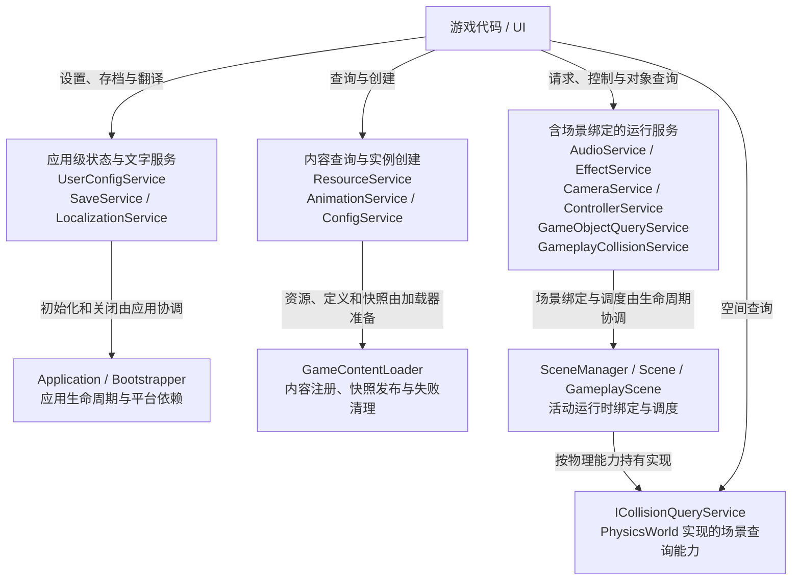

# 服务架构总览

本页索引当前 12 个具体服务与 1 个物理查询接口。图按资源、呈现、配置和场景能力聚合；同一框内的服务仍有各自实现和生命周期，不表示同一拥有者。完整初始化顺序见[项目启动全流程](startup.md)。

## 服务协作关系

连线标签说明调用或生命周期协作；跨服务依赖的细节在各模块图中展开。全局服务入口不延长场景、对象、资源或监听器的寿命。

源码：[application.cpp](../../../engine/application/application.cpp) · [game_content_loader.cpp](../../../engine/loading/game_content_loader.cpp) · [scene_manager.cpp](../../../engine/scene/scene_manager.cpp)

## 逐服务架构图

| 服务或接口 | 架构图 |
| --- | --- |
| `ResourceService` | [资源服务与加载架构](subsystems/resources/README.md#resource-service-architecture) |
| `AudioService` | [音频服务架构](subsystems/audio.md#audio-service-architecture) |
| `CameraService` | [相机服务架构](subsystems/camera.md#camera-service-architecture) |
| `ConfigService` | [只读配置服务架构](subsystems/runtime-config.md#config-service-architecture) |
| `UserConfigService` | [用户配置服务架构](subsystems/runtime-config.md#user-config-service-architecture) |
| `SaveService` | [存档服务架构](subsystems/save.md#save-service-architecture) |
| `ControllerService` | [控制器服务架构](subsystems/input/architecture.md#controller-service-architecture) |
| `GameplayCollisionService` | [玩法碰撞服务架构](subsystems/physics/07-gameplay-collision-runtime.md#gameplay-collision-service-architecture) |
| `ICollisionQueryService` | [物理查询服务契约](subsystems/physics/05-collision-algorithms.md#collision-query-service-architecture) |
| `AnimationService` | [动画服务架构](subsystems/animation-and-effects.md#animation-service-architecture) |
| `EffectService` | [特效服务架构](subsystems/animation-and-effects.md#effect-service-architecture) |
| `LocalizationService` | [本地化服务架构](subsystems/localization.md#localization-service-architecture) |
| `GameObjectQueryService` | [对象查询服务架构](subsystems/object-query.md#object-query-service-architecture) |

## 阅读边界

Service 不统一等于 Manager 包装：AudioService、SaveService 和配置服务直接持有状态；CameraService 和玩法碰撞服务借用场景运行时；ICollisionQueryService 是由 PhysicsWorld 实现的契约。

已有非服务专题继续由[UI 架构](subsystems/ui/README.md)、[场景生命周期](subsystems/scene-lifecycle.md)和[物理架构](subsystems/physics/README.md)说明。返回[架构首页](README.md)。
