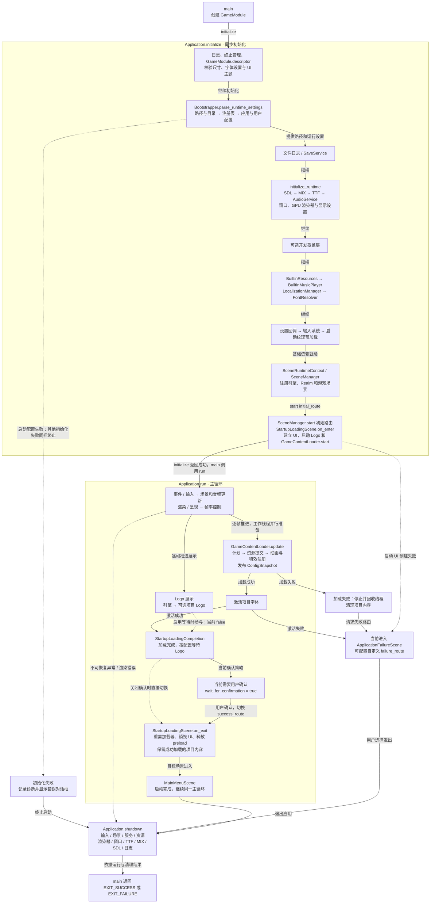

# 项目启动全流程

本图按当前示例 GameModule 的 initial_route 展示从 main 到主菜单的流程。引擎允许项目指定其他初始路由和成功目标，MainMenu 不是引擎固定入口。

## 初始化与运行阶段

源码：[main.cpp](../../../main.cpp) · [application.cpp](../../../engine/application/application.cpp) · [application_scene_composition.cpp](../../../engine/application/composition/application_scene_composition.cpp) · [bootstrapper.cpp](../../../engine/bootstrap/bootstrapper.cpp) · [startup_loading_scene.cpp](../../../engine/builtin/scenes/startup_loading_scene.cpp)

## 当前示例与引擎选项

当前示例进入 StartupLoading，成功后进入 MainMenu；wait_for_logo_sequence=false、wait_for_confirmation=true，且未配置项目 Logo 或自定义失败路由。Payload 的等待 Logo 默认值为 true；关闭等待不会停止 Logo 播放，关闭确认则可直接切换。

源码：[example_game_module.cpp](../../../game/application/example_game_module.cpp) · [startup_loading_scene_payload.h](../../../engine/builtin/scenes/startup_loading_scene_payload.h) · [startup_loading_flow.h](../../../engine/builtin/scenes/startup_loading_flow.h)

## 时序与失败边界

- initialize 内进入初始场景；on_enter 同步准备清单和计划并启动工作线程。run 开始后才持续更新加载进度和展示，不必等待所有项目内容才进入主循环。
- 工作线程只准备 CPU 数据，GPU 资源创建和提交位于主线程；完整链路见[资源服务图](subsystems/resources/README.md#resource-service-architecture)。
- 启动配置、平台或必需预加载失败会终止初始化。图中的普通初始化失败有日志和对话框路径；不可恢复渲染错误由终止边界处理。
- 内容失败先清理加载线程与项目内容，再请求 failure_route 或内建错误场景；字体激活及启动展示失败进入失败路由。一般场景生命周期异常由 SceneManager 尝试错误场景恢复，无法恢复才终止。
- 退出启动场景释放 preload 缓存，成功加载的项目内容继续保留。应用关闭先结束使用者与播放，再释放资源，最后销毁平台设施；清理失败会影响退出结果。

图中的实线表示主流程，虚线表示条件或异常分支。[启动配置指南](../user-guide/builtin-scenes/startup-loading.md) · [服务总览](services.md) · [场景生命周期](subsystems/scene-lifecycle.md)。
