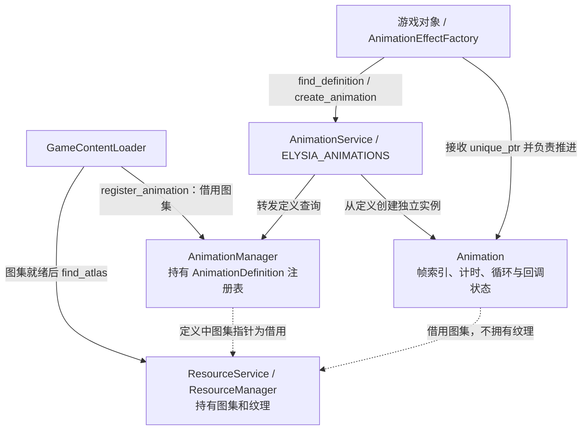
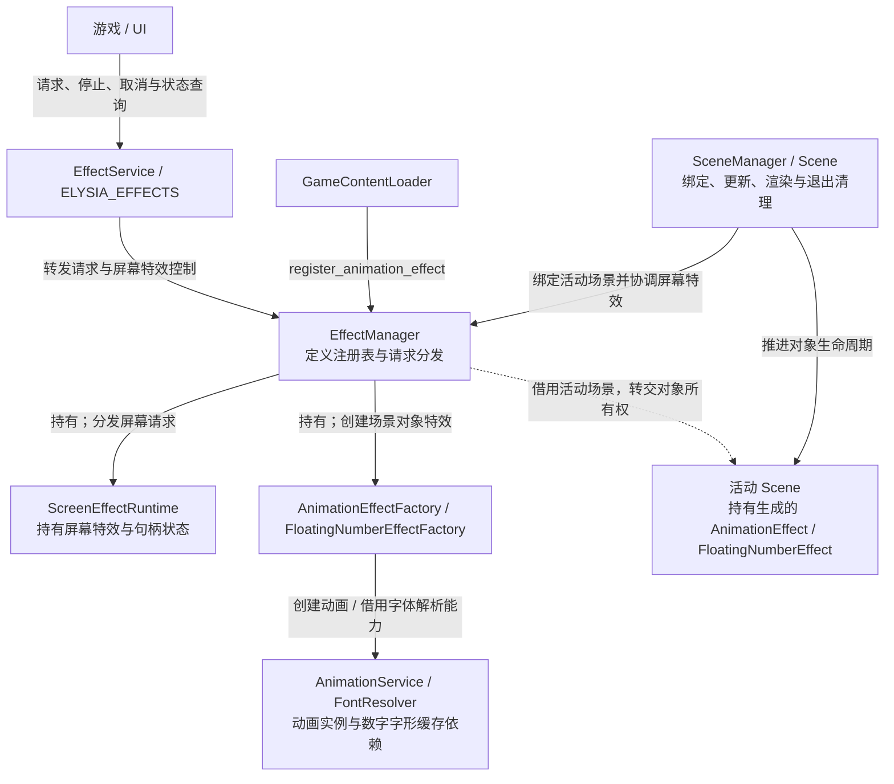

# 动画与特效架构

本文解释共享动画定义、独立播放实例、特效分发和场景所有权。游戏接入见[动画与特效指南](../../user-guide/systems/animation-and-effects.md)，内容注册链路见[资源加载](resources/README.md)。

## 动画服务架构

注册表保存共享定义，创建接口返回带独立播放状态的动画实例。

find_definition 返回借用，create_animation 返回调用方拥有的 unique_ptr。定义和实例都借用资源图集；重载前必须停止使用旧实例和定义。缺失定义时创建返回 nullptr，不触发按需加载。

源码：[animation_service.cpp](../../../../engine/animation/animation_service.cpp) · [animation_manager.h](../../../../engine/animation/runtime/animation_manager.h) · [animation.h](../../../../engine/animation/animation.h)

## 特效服务架构

屏幕特效由 Manager 的运行时持有，动画和飘字特效对象转交活动 Scene 持有。

EffectManager 借用活动场景和渲染、字体依赖；缺少运行时或定义时返回明确失败。屏幕特效不跨场景退出；场景对象特效遵循对象生命周期，不能将 EffectService 视为资源加载器。

源码：[effect_service.cpp](../../../../engine/effects/effect_service.cpp) · [effect_manager.h](../../../../engine/effects/runtime/effect_manager.h) · [effect_manager.cpp](../../../../engine/effects/runtime/effect_manager.cpp)

相关入口：[服务架构总览](../services.md) · [架构首页](../README.md)。
