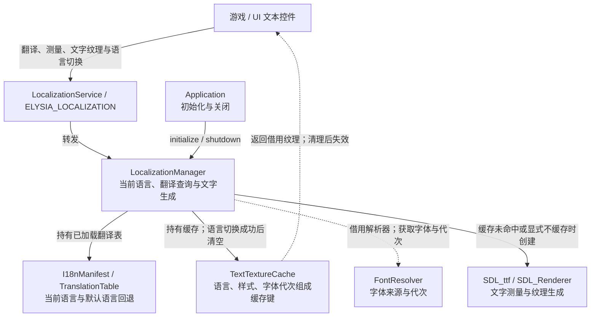

# 本地化与文字缓存架构

本文解释翻译、字体解析与文字纹理的协作；游戏接入见[本地化指南](../../user-guide/systems/localization.md)。本地化在应用初始化阶段就绪，早于项目内容加载；项目字体加载完成后再激活，见[启动全流程](../startup.md)。

## 本地化服务架构

服务统一翻译、测量和文字纹理入口；Manager 持有翻译表及缓存，并借用应用的 FontResolver。

缓存纹理返回借用；成功切换语言、清缓存或关闭后旧缓存指针失效。字体代次参与缓存键，避免复用旧字体纹理。create_uncached_raw_text_texture 返回调用方拥有的 CachedTexturePtr，与缓存借用不同；tr 的 string_view 也不延长翻译表寿命。

源码：[localization_service.cpp](../../../../engine/localization/localization_service.cpp) · [localization_manager.h](../../../../engine/localization/localization_manager.h) · [text_texture_cache.h](../../../../engine/localization/text_texture_cache.h)

相关入口：[服务架构总览](../services.md) · [架构首页](../README.md)。
