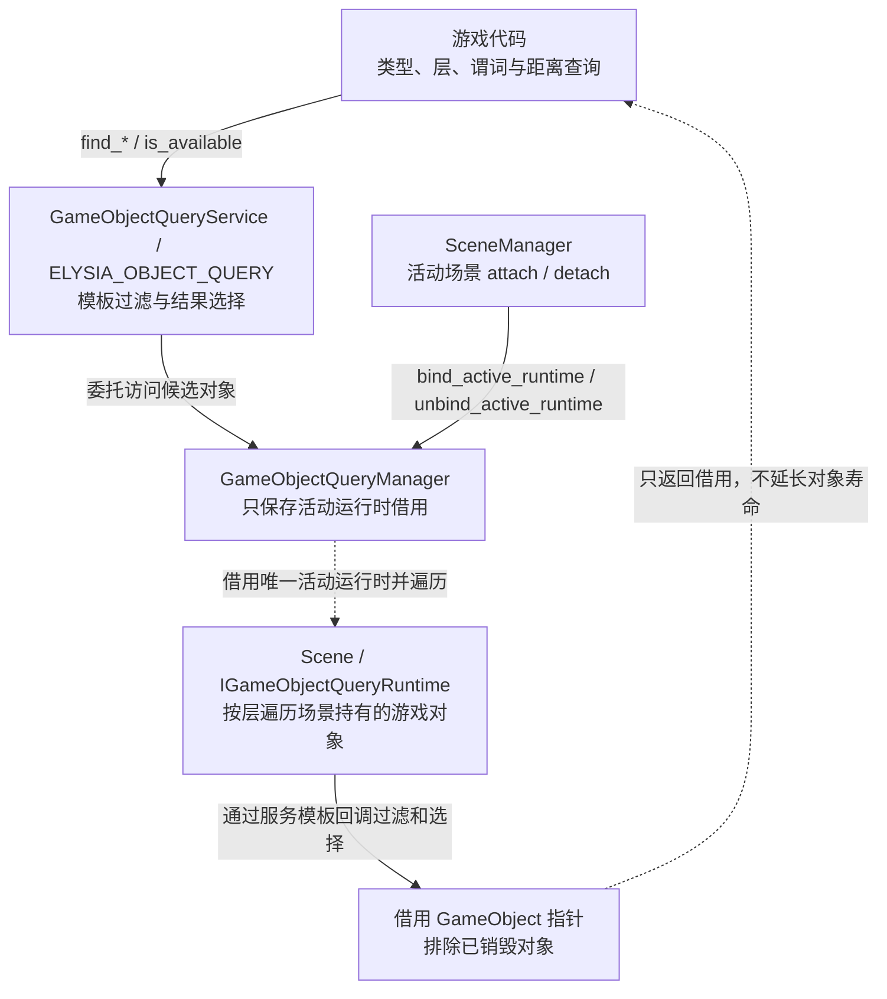

# 活动场景对象查询架构

本文解释查询服务如何访问活动场景以及结果的借用关系。游戏用法见[对象查询指南](../../user-guide/systems/object-query.md)，物理几何查询见[碰撞查询契约](physics/05-collision-algorithms.md#collision-query-service-architecture)。

## 对象查询服务架构

全局入口访问当前 Scene 提供的对象集合；类型、谓词与评分选择在服务模板中完成。

结果是借用，不提供空间索引或物理精确检测，也不延长对象寿命。未绑定运行时可通过 is_available 判断；查询没有候选时返回空结果。切换场景或对象销毁后应重新查询，遍历期间遵守场景安全修改阶段。

源码：[game_object_query_service.h](../../../../engine/object_query/game_object_query_service.h) · [game_object_query_manager.cpp](../../../../engine/object_query/runtime/game_object_query_manager.cpp) · [scene.h](../../../../engine/scene/scene.h)

相关入口：[服务架构总览](../services.md) · [架构首页](../README.md)。
