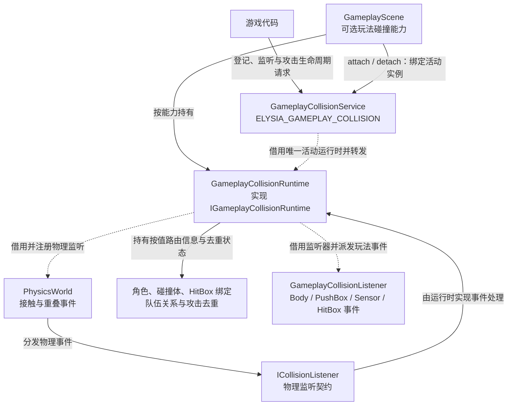

# 从物理接触到 Gameplay 事件

物理层报告引擎形状身份以及接触或重叠值，不判断攻击是否敌对、是否造成伤害。`GameplayCollisionRuntime` 持有角色、队伍和碰撞角色绑定，将物理结果转换成 Body、PushBox、Sensor 和 HitBox 事件。

## 玩法碰撞服务架构

物理世界产生接触事实，玩法运行时解释绑定、队伍和攻击实例，再派发玩法事件。

服务只借用活动运行时，不持有角色或监听器。解绑服务不等于清空缓存场景的碰撞运行时；Reset 也不会自动调用 collision_runtime.clear。监听器须活过事件批次，伤害策略由游戏决定。

源码：[gameplay_collision_service.cpp](../../../../../engine/gameplay/collision/gameplay_collision_service.cpp) · [gameplay_collision_runtime.h](../../../../../engine/gameplay/collision/gameplay_collision_runtime.h) · [gameplay_scene.cpp](../../../../../engine/gameplay/scene/gameplay_scene.cpp)

## 玩法策略与事件寿命

攻击实例去重和伤害策略位于物理层之上。存在传感器不代表它一定能伤害目标。

HitBox 在 `Begin` 时通过 `team_relation(hit_box.collider.team, hurt_box.team)` 判断敌我，再按攻击实例与受击 owner 去重。攻击队伍在登记时按值保存，不查询 instigator 的 ActorCollisionRig，也不随来源换队自动更新。instigator 是非零归属标识，允许来源 Actor 未登记或已注销；伤害计算、击杀归属和来源离场是否取消攻击由游戏决定。

独立攻击使用自己的 collider.owner，无需登记 ActorCollisionRig 或增加身份 Collider。解绑来源 Actor 只清理以其为 owner 的绑定，不影响其他 owner 的攻击；攻击结束仍需 end_attack_instance 清理绑定与去重。每个 ColliderId 只登记一个玩法角色，HitBox 不同时路由 BodyContactEvent；物理响应及撞墙事件由物理层处理。

运行时为活动对象对保留按值存储的绑定信息，因此角色解绑后仍能路由 `End`，不需要查找已销毁的 Box2D 对象。显式调用 `GameplayCollisionRuntime::clear()` 会清空角色绑定、攻击去重、缓存路由、玩法监听登记和自定义阵营解析器。Reset 路由先由基础 Scene 重置输入、暂停、固定步和相机；`GameplayScene::on_runtime_reset()` 只重置控制上下文，随后调用游戏的 `on_reset()`，不会自动调用碰撞运行时的 `clear()`。离开缓存场景只解绑活动服务；游戏仍须按业务清理攻击和监听。对象回收会解绑其碰撞体，实例销毁才释放运行时本身。

## 离散接触与回调

`Begin`、`Stay` 和 `End` 描述采样得到的接触。传感器是离散检测，高速攻击需要显式投射；物理子弹 CCD 不使传感器连续化。

监听器可在分发期间请求物理修改，当前事件批次保持稳定。监听器本身必须活过该批次。涉及场景对象增删时，仍须遵守[场景安全阶段](../scene-lifecycle.md)，不能把物理延迟命令误当作任意修改场景对象的许可。
