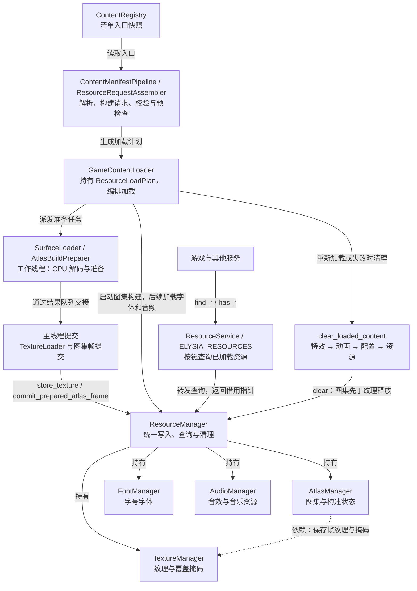

# 资源加载管线

本页解释资源请求如何组装、提交及交给各服务。声明素材的步骤见[资源指南](../../../user-guide/content/resources.md)，完整 JSON 契约见[资源格式参考](../../../reference/resources/README.md)。

## 总加载链路

加载器负责准备与提交，服务只查询已经注册的资源。

所有查询指针均为借用。重新加载和失败会清理项目内容；ResourceManager 内按 Atlas、Texture、Font、Audio 顺序清理。BuiltinResources 与 BootstrapTextureCache 独立持有内建和预加载资源，不进入项目资源池。

源码：[resource_service.cpp](../../../../../engine/resources/resource_service.cpp) · [resource_manager.cpp](../../../../../engine/resources/runtime/resource_manager.cpp) · [game_content_loader.cpp](../../../../../engine/loading/game_content_loader.cpp)

注册表的启动配置、预加载与本地化入口由启动和应用初始化处理；图中的项目内容加载使用 required 与 additional 中对应的资源清单。`additional` 不按模块名选择专用加载器；项目新增模块时仍使用同一结构约定，并按模块名的确定性顺序遍历。`ryougi_sample` 的命名空间为空，只声明动画能力；实际配置链路见[资源参考](../../../reference/resources/entity-content.md#当前仓库样例)。

通用加载器按以下阶段组装请求；某类能力未声明时，该阶段没有对应模块请求：

1. 核心 Animation/Atlas。
2. 全部附加内容模块的 Animation/Atlas。
3. 核心及模块的 EffectDefinition。
4. 核心及模块的 Texture。
5. Font、核心 Audio 和模块 Audio。

运行时仍先完成 `Atlas`，再注册全部 `Animation`，最后注册 EffectDefinition。因此 `Effect` 只绑定已经生成的 `Animation`，不负责加载图片或创建 `Animation`。

资源请求的来源、资源键及冲突检查约定见[格式参考](../../../reference/resources/README.md#来源与重复-key)。配置快照的发布边界见[运行时配置](../runtime-config.md)。
